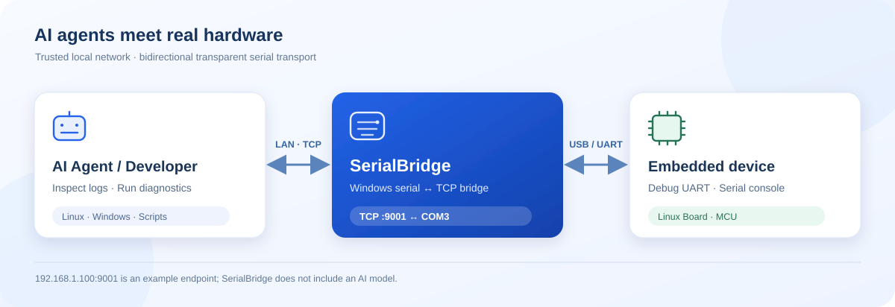
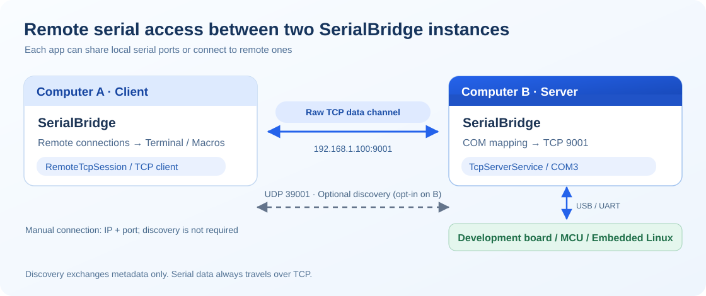
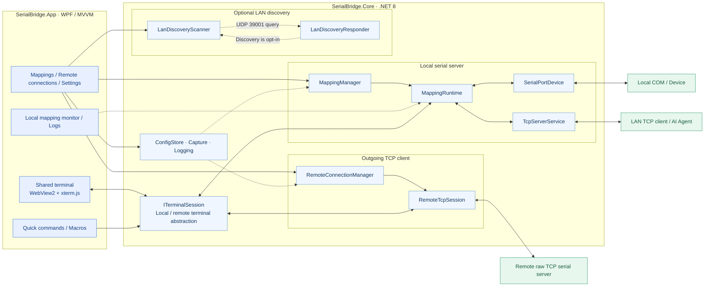

<div align="center">
  

  # SerialBridge

  **Turn physical serial ports into network-accessible remote terminals.**

  Give serial consoles an SSH/Telnet-like remote-terminal experience without changing their protocol: share local COM ports over raw TCP, or discover and connect to remote SerialBridge instances from the same application.

  [](https://github.com/SuperStrain/SerialBridge/actions/workflows/build.yml)
  [](https://github.com/SuperStrain/SerialBridge/releases/latest)
  [](https://github.com/SuperStrain/SerialBridge/releases)
  [](#requirements)
  [](LICENSE)

  [简体中文](README.md) · **English**

  [**Download latest**](https://github.com/SuperStrain/SerialBridge/releases/latest) · [User guide](docs/用户使用说明.md) · [Report an issue](https://github.com/SuperStrain/SerialBridge/issues) · [Contribute](#contributing)
</div>

---

## ✨ Why SerialBridge?

**Access a serial console from another computer as easily as opening a remote terminal.** SerialBridge provides an experience reminiscent of SSH or Telnet, but **does not implement either protocol and does not provide SSH-style encryption or authentication**.

**The primary goal is to connect AI agents to real hardware over serial.** Plug your USB-to-serial adapter into a Windows computer running SerialBridge. AI agents on the same LAN can then connect over TCP to read boot logs, send diagnostic commands, collect device responses, and use those responses to guide further investigation. This reduces manual copy-and-paste between an AI assistant and a serial terminal, speeding up embedded debugging and regression testing.

Regular TCP clients and human-operated terminals work too. **SerialBridge is a transparent transport, not a built-in AI model or an autonomous device controller.**

<div align="center">
  
</div>

> **Transparent forwarding:** SerialBridge transfers raw bytes. It does not wrap connections in Telnet or another control protocol. Serial port settings are configured on the Windows host.

## 🚀 Features

| Feature | What it does |
| --- | --- |
| 🤖 **AI agent access** | Agents on the same LAN can interact with device serial ports over TCP using the included Agent Skill or Python script |
| 🔌 **Independent mappings** | Map each COM port to its own TCP listening endpoint; start and stop mappings individually |
| 🌐 **Outgoing TCP client** | Connect to another SerialBridge serial-to-TCP endpoint and use the existing terminal and command macros |
| 🔎 **LAN discovery** | Find opted-in SerialBridge hosts, their available COM mappings, IP addresses and TCP ports; discoverability is off by default |
| 🔄 **Bidirectional raw transfer** | Forward arbitrary binary data with single- or multi-client modes and serialized serial writes |
| 🛡️ **Connection recovery** | Configurable serial reconnection, occupied-port detection, slow-client protection, and bounded queues |
| 💻 **Built-in terminal** | WebView2 + xterm.js with direct keystroke forwarding, search, scrollback, and font zoom |
| ⚡ **Quick commands & macros** | Optional terminal command bar, Text / HEX presets, CR / LF / CRLF, step delays, and cancellation |
| 📊 **Traffic monitoring & logs** | HEX / ASCII views, direction, timestamps, counters, export, and configurable capture |
| 🖥️ **Windows desktop UX** | Fluent-styled WPF, light/dark theme, system tray, startup and mapping restoration |
| 📦 **Installation & updates** | Windows installer or portable ZIP, GitHub Releases update checks, settings preserved on upgrade |

> Macros send steps sequentially with **fixed delays**; they do **not** wait for a remote shell prompt or command completion. See [Quick commands & macros](docs/快捷命令与宏.md) (Chinese).

## 🌐 Remote serial terminals between two SerialBridge computers

**Computer B (server)** shares a physical `COM3` port via raw TCP port `9001`; **Computer A (client)** connects using SerialBridge's built-in terminal, without a USB-to-serial adapter attached locally.

```text
Computer A: SerialBridge remote TCP terminal ⇄ LAN / raw TCP ⇄ Computer B: 192.168.1.100:9001 → COM3 → device
```

<div align="center">
  
</div>

**Discover and connect**

1. On computer B, start the `COM3 → TCP 9001` mapping, bound to a LAN-accessible interface.
2. On B, explicitly enable **Settings → LAN discovery → Allow other SerialBridge instances to discover this computer**. The setting is **off by default**.
3. On A, open **Remote connections → Scan LAN** to see the visible host, IP, mapping name, COM port, serial settings and TCP port.
4. Choose a mapping and click **Save and Connect** to launch the shared terminal.

**Connect manually**

On A, open **Remote connections → Saved connections**, enter B's IP/hostname and TCP port, save, and choose **Connect → Terminal**. Optional reconnect and connect-at-startup switches are **off by default**. Closing a terminal view keeps the TCP connection active; use **Disconnect** to close it.

> Discovery uses **UDP port 39001** within the same IPv4 broadcast domain; host firewalls or network isolation may prevent scanning. Manual IP/port connections remain available even when discovery is disabled. **This is raw TCP serial transport, not an SSH/Telnet server.** The remote host controls COM parameters; commands are never replayed automatically after reconnect.

## 🤖 Debug real hardware with AI agents

### 🎬 Video demo

See how an AI agent on the same LAN uses SerialBridge to send commands to a device over serial and read the logs it returns.

https://github.com/user-attachments/assets/e6fa1c20-761f-4ae9-a3da-4ff2781e7a71

### Connection example

For example, your AI agent runs on a Linux workstation while the development board's USB serial adapter is attached to a separate Windows PC:

1. On Windows, configure SerialBridge to map the board's `COM3` to TCP port `9001`.
2. From the same trusted LAN, use a raw TCP client or the included [serial-tcp-uart Agent Skill](skills/serial-tcp-uart/SKILL.md) and [Python script](skills/serial-tcp-uart/scripts/serial_session.py).
3. The agent can collect logs, send authorized diagnostic commands, wait for device prompts, and analyze responses. Developers can also use the built-in terminal for hands-on control.

```bash
# Run on the agent's Linux host; replace with your Windows host's LAN IP
python3 skills/serial-tcp-uart/scripts/serial_session.py \
  --host 192.168.1.100 --port 9001 exec "uname -a"
```

> **Scope:** SerialBridge does not run an AI model or agent workflow. Automation belongs to the external agent/script. Login handling, prompt matching, and privileges depend on the target device and agent setup. State-changing operations such as flashing firmware or rebooting a device should require explicit authorization.

## 📥 Install

Visit [**GitHub Releases**](https://github.com/SuperStrain/SerialBridge/releases/latest) and download either:

| Package | Recommended use |
| --- | --- |
| `SerialBridge-Setup-<version>-x64.exe` | **Recommended** — guided installation, shortcuts, and uninstall entry |
| `SerialBridge-Portable-<version>-win-x64.zip` | Portable — extract and run `SerialBridge.exe` |

### Requirements

- **Windows 10 1809 or newer / Windows 11, x64** (the targeted platform; compatibility with older Windows installations should be verified on real machines)
- An available COM port; USB-to-serial adapters may require their vendor-supplied drivers
- Self-contained deployment: **no separate .NET Runtime installation required**
- The embedded terminal uses **Microsoft Edge WebView2 Runtime**; install [WebView2 Runtime](https://developer.microsoft.com/microsoft-edge/webview2/) if it is missing

## ⚡ Quick start

**Example: expose your Windows machine's COM3 over TCP port 9001.**

1. Open SerialBridge, select **Add Mapping**, choose `COM3`, and set the serial parameters (for example, `115200 8N1`).
2. Set the TCP port to `9001`, select a suitable listening interface/address for LAN access, save, and **Start** the mapping.
3. Connect from another device using the **Windows host's actual LAN IP** and port `9001`, as shown in the app.

```text
Windows: COM3 @ 115200 8N1  ⇄  0.0.0.0:9001 (listen)
Linux:   connect to 192.168.1.100:9001 (example IP)
```

`0.0.0.0` means “listen on all interfaces”; it is **not** a destination IP. Use the real host address and check Windows Firewall rules.

### Interactive access from Linux

For terminal-like keystroke handling (Tab completion, Ctrl+C, arrows), use `socat` to create a local PTY and open it with `picocom`:

```bash
sudo apt install socat picocom
socat PTY,link=/tmp/ttydev,waitslave TCP:192.168.1.100:9001 &
picocom /tmp/ttydev
```

Close `picocom` and clean up the matching `socat` process afterward. See the [user guide](docs/用户使用说明.md) (Chinese) for additional connection options and troubleshooting.

### One-click terminal commands

Open the mapping's **Serial Terminal** → **Quick Commands / Macros** → **Edit**. Create a Text step such as `uname -a` with a `CR` ending, save it, and use the command bar button to send it again. Multi-step macros support per-step delays and cancellation of **unsent** steps.

## 🏗️ Architecture



- **Language & UI:** C#, .NET 8, WPF, WPF-UI, CommunityToolkit.Mvvm
- **Two roles in one app:** SerialBridge can expose local COM ports over TCP and initiate outgoing raw TCP serial sessions. `ITerminalSession` lets the terminal work with local and remote connections.
- **Optional discovery:** `LanDiscoveryScanner` and `LanDiscoveryResponder` use UDP 39001 to exchange available mapping metadata with opted-in hosts; serial payloads still travel over raw TCP.
- **Serial & networking:** `System.IO.Ports`, `TcpListener` / Socket, `System.Threading.Channels`
- **Terminal:** WebView2 + xterm.js
- **Testing & packaging:** xUnit, simulated serial streams, GitHub Actions, Inno Setup

## 🛠️ Build from source

On Windows, install the [.NET 8 SDK](https://dotnet.microsoft.com/download/dotnet/8.0) and Python 3. Install Inno Setup 6.5+ if you also want to build the installer.

```powershell
git clone https://github.com/SuperStrain/SerialBridge.git
cd SerialBridge

# Build and run tests
dotnet test SerialBridge.sln -c Debug --nologo

# Publish a self-contained Windows x64 application
dotnet publish src/SerialBridge.App -c Release -r win-x64 --self-contained true -o dist/publish

# See the build guide for icon processing and the full installer workflow
```

See the [developer build & packaging guide](docs/编译与打包说明.md) (Chinese) and [GitHub Actions](https://github.com/SuperStrain/SerialBridge/actions).

## 📚 Documentation & resources

| Resource | Description |
| --- | --- |
| [User guide](docs/用户使用说明.md) | Mapping configuration, Windows/Linux connections, troubleshooting (Chinese) |
| [Quick commands & macros](docs/快捷命令与宏.md) | Command bar, Text / HEX, delays, and safety boundaries (Chinese) |
| [Developer build guide](docs/编译与打包说明.md) | Toolchain, builds, packaging and publishing (Chinese) |
| [Tests & known limitations](docs/测试记录.md) | Test history and manual verification notes (Chinese) |
| [Remote client and LAN discovery guide](docs/用户使用说明.md#35-远程-tcp-客户端与局域网发现) | Remote COM access, discovery, connection management, firewall troubleshooting (Chinese) |
| [serial-tcp-uart Agent Skill](skills/serial-tcp-uart/SKILL.md) | Agent-oriented skill and scripts for using serial mappings over TCP (Chinese) |

## 🔐 Security

**Raw TCP forwarding has no built-in encryption, authentication, or Telnet negotiation.** Discoverability is disabled by default; when enabled, hosts on the local network can obtain published COM mapping metadata. Discovery replies are unauthenticated. Use SerialBridge on trusted networks only, restrict the listening address and host firewall rules, and **do not expose the bridge directly to the public Internet**.

In multi-client mode, serial data is broadcast to connected clients and inbound writes are serialized, but requests and responses from different clients are **not automatically correlated**. Passwords in quick-command presets are currently saved in local configuration; avoid storing sensitive real credentials.

## 🤝 Contributing

Issues and pull requests are welcome:

1. Create a focused feature branch.
2. Run `dotnet test SerialBridge.sln -c Debug`.
3. Explain the purpose, testing, and any effects on serial/network compatibility.

If SerialBridge helps your workflow, consider giving the repository a ⭐.

## 📄 License

Licensed under the [MIT License](LICENSE).
