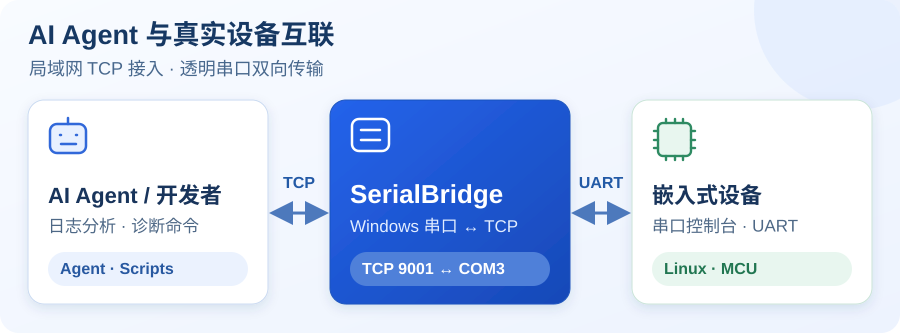
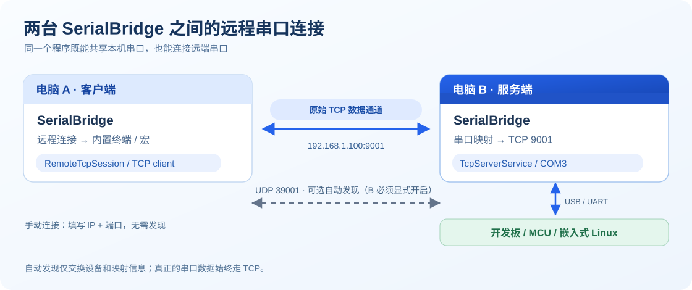
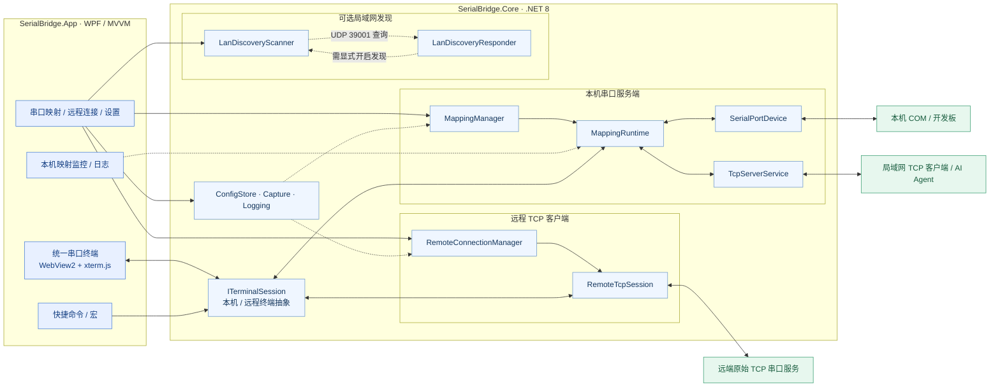

<div align="center">
  

  # SerialBridge

  **让 AI Agent 突破本机串口限制，通过局域网远程操作其他电脑连接的硬件设备。**

  AI Agent 可以直接操作本机串口，但当设备连接在另一台电脑上时，如何远程访问？

  SerialBridge 将 Windows 物理串口转换为局域网 TCP 服务，让其他电脑上的 AI Agent 无需直接连接硬件，就能跨电脑读取串口日志、发送调试命令并分析设备反馈；也支持通过内置远程连接访问其他 SerialBridge。

  [](https://github.com/SuperStrain/SerialBridge/actions/workflows/build.yml)
  [](https://github.com/SuperStrain/SerialBridge/releases/latest)
  [](https://github.com/SuperStrain/SerialBridge/releases)
  [](#系统要求)
  [](LICENSE)

  **简体中文** · [English](README.en.md)

  [**下载最新版**](https://github.com/SuperStrain/SerialBridge/releases/latest) · [使用指南](docs/用户使用说明.md) · [反馈问题](https://github.com/SuperStrain/SerialBridge/issues) · [参与贡献](#参与贡献)
</div>

---

## ⚡ 快速开始：让 AI Agent 跨电脑访问设备串口

**目标：** 开发板的物理串口连接在 Windows 电脑 A 上；AI Agent 在同一可信局域网的电脑 B 上，**通过 TCP 跨电脑访问设备串口**，读取日志、执行诊断命令并分析结果。

### 1. Windows 端：把串口共享到局域网

从 [GitHub Releases](https://github.com/SuperStrain/SerialBridge/releases/latest) 安装或解压 SerialBridge，将开发板通过 USB 转串口连接到 Windows。

在左侧 **串口映射** 页面点击 **新增映射**，选择实际 COM 口（如 `COM3`），按开发板要求设置波特率（如 `115200 8N1`），将 TCP 监听端口设为 `9001`，选择可被局域网访问的监听地址，保存并启动映射。

> `0.0.0.0` 只表示监听所有本机 IPv4 网卡，**不是 Agent 的连接地址**。从界面“本机 IPv4”查看可达的 Windows IP，并检查入站防火墙。

### 2. Agent 端：接入串口工具

在运行 AI Agent 的 Linux 电脑上获取本仓库，并让 Agent 使用随仓库提供的 [serial-tcp-uart Skill](skills/serial-tcp-uart/SKILL.md) 和 [Python 脚本](skills/serial-tcp-uart/scripts/serial_session.py) 连接 `192.168.1.100:9001`（示例地址，替换为 Windows 主机实际 IP）。脚本仅依赖 Python 3 标准库。

例如先获取仓库（已下载源码可跳过）：

```bash
git clone https://github.com/SuperStrain/SerialBridge.git
cd SerialBridge
```

具体如何让 Agent 加载 Skill，取决于所用 Agent 平台；可以参考 [Skill 部署说明](skills/serial-tcp-uart/SKILL.md#部署到-linux-主机)。

Agent 需要能访问这些本地文件并获得执行工具的权限；**仅安装 SerialBridge 不会自动让 AI Agent 具备串口操作能力**。

### 3. 让 Agent 读取日志并执行诊断命令

可以向已配置上述 Skill / 工具的 Agent 提出这样的任务：

> 通过 SerialBridge 连接 `192.168.1.100:9001`，读取开发板串口输出，查询 Linux 版本和内存信息，根据返回结果分析系统状态。只执行只读诊断，不要修改设备配置。

或者在 Agent 所在电脑的仓库根目录下，先用脚本验证链路（**这是工具调用示例，不等同于 AI 自主分析**）：

```bash
python3 skills/serial-tcp-uart/scripts/serial_session.py \
  --host 192.168.1.100 --port 9001 exec "uname -a"
```

命令能否执行取决于设备是否已登录 Shell、串口权限及提示符匹配情况；必要时按 [Skill 说明](skills/serial-tcp-uart/SKILL.md) 配置登录和 `--prompt`。完成后应断开会话，避免长期占用单客户端串口映射。

### 🎬 实际演示：AI Agent 通过串口操作开发板

下方视频演示 AI Agent 在局域网中通过 SerialBridge 发送命令，并读取真实设备的串口返回信息。

https://github.com/user-attachments/assets/e6fa1c20-761f-4ae9-a3da-4ff2781e7a71

> **安全边界：** SerialBridge 负责原始 TCP ↔ 串口字节透传，**不内置 AI 模型、SSH/Telnet 认证或加密**。重启、刷写固件等会改变设备状态的操作需事先获得明确授权。更多人工交互方式、快捷命令和排障见 [用户使用指南](docs/用户使用说明.md)。

## ✨ 为什么选择 SerialBridge？

**让串口不再局限于插着 USB 转串口线的那台电脑。** SerialBridge 将串口网络化，使远端的开发者和 AI Agent 也能像使用 SSH / Telnet 远程终端一样，打开设备控制台、输入命令并查看实时响应。**这里的“像”指使用体验，不表示采用 SSH、Telnet 或具有其认证、加密能力。**

**它把串口转化为 Agent 可以调用的网络入口。** Agent 通过现有工具链访问真实设备，开发者也可以随时用内置终端接管。无需在 AI 和串口终端之间反复复制日志、转发命令。

SerialBridge 同样支持普通 TCP 客户端和人工调试工具；**它提供的是透明串口通道，而不是内置 AI 模型或无需授权的自动控制系统**。

<div align="center">
  
</div>

> **透明透传**：SerialBridge 转发原始字节，不将 TCP 流量包装成 Telnet 或其他控制协议。实际串口参数由 Windows 端映射配置决定。

## 🚀 主要功能

| 功能 | 说明 |
| --- | --- |
| 🤖 **AI Agent 访问设备** | 同一局域网内的 Agent 可通过 TCP 与设备串口交互；支持配套 Agent Skill / Python 脚本 |
| 🔌 **多路串口映射** | 一条映射对应一个 COM 端口和 TCP 监听地址；独立启动、停止和配置 |
| 🌐 **远程 TCP 客户端** | 作为客户端连接其他 SerialBridge 的 TCP 串口端口，直接复用内置终端与快捷命令 |
| 🔎 **局域网设备发现** | 扫描主动允许被发现的 SerialBridge，查看开放的 COM、IP、TCP 端口；服务端发现开关默认关闭 |
| 🔄 **双向透明传输** | 支持任意二进制字节、单/多客户端模式、串口写入顺序化 |
| 🛡️ **断线恢复** | 串口拔插后可自动重连；端口占用检测、慢客户端保护、写入队列背压 |
| 💻 **内置串口终端** | WebView2 + xterm.js，逐键透传、文本搜索、滚动历史、字体缩放 |
| ⚡ **快捷命令与宏** | 终端底部可显示常用命令按钮；Text / HEX、CR / LF / CRLF、分步延时与取消 |
| 📊 **实时监控与日志** | HEX / ASCII、收发方向、时间戳、统计、导出及可配置日志采集 |
| 🖥️ **桌面体验** | WPF Fluent 风格、深浅主题、系统托盘、开机自启、映射恢复 |
| 📦 **安装与更新** | Windows 安装包 / 便携 ZIP、GitHub Releases 更新检查、升级保留配置 |

> 宏是**固定延时的顺序发送**，不自动等待设备 Shell 提示符或命令执行完成。详见 [快捷命令与宏说明](docs/快捷命令与宏.md)。

## 🌐 两台 SerialBridge 之间的远程串口操作

**电脑 A 当客户端，电脑 B 当服务端。** 电脑 B 的开发板通过 USB 转串口接到 `COM3`，SerialBridge 将它共享到 `9001`；电脑 A 无需插串口线，就能使用自己的 SerialBridge 打开终端，读写远端设备。

```text
电脑 A（SerialBridge TCP 客户端）                 电脑 B（SerialBridge TCP 服务端）
远程 TCP → 终端 / 快捷命令    ⇄   局域网 TCP   ⇄   192.168.1.100:9001 → COM3 → 开发板
```

<div align="center">
  
</div>

**方式一：自动发现并连接（推荐）**

1. 在电脑 B 新建并启动 `COM3 → TCP 9001` 映射，确保监听地址允许局域网访问。
2. 电脑 B 打开 **设置 → 局域网发现**，主动开启 **允许被局域网内的 SerialBridge 发现**。此开关**默认关闭**，只有开启后才响应 UDP 扫描。
3. 电脑 A 在主窗口左侧点击 **远程连接** → **扫描局域网**，查看发现的电脑名称、IP、映射名称、COM、TCP 端口和串口参数。
4. 选择目标 COM 映射，点击 **保存并连接**，软件建立原始 TCP 会话并打开终端。

**方式二：手动连接**

不想开放设备发现时，在电脑 A 的 **远程连接 → 已保存连接** 输入连接名称、电脑 B 的 IP / 主机名和 TCP 端口，保存后点击 **连接 → 终端**。可按需打开自动重连与启动时连接；**默认均关闭**。关闭终端窗口不会断开 TCP，使用连接列表的 **断开** 才会结束会话。

> **协议与网络边界：** 数据通道始终是**原始 TCP 字节透传**，不使用 SSH/Telnet 协议、虚拟 COM 驱动或远程控制 API。串口波特率等参数由电脑 B 设置。自动发现使用同一 IPv4 广播域中的 **UDP 39001**，可能受到 Windows 防火墙、网卡和 VLAN 的限制；扫描失败仍可手动连接。只列出远端正在监听、可供局域网访问的映射。网络中断后不会自动重发未完成的命令。

## 📥 安装

前往 [**GitHub Releases**](https://github.com/SuperStrain/SerialBridge/releases/latest)，选择适合你的版本：

| 版本 | 适用场景 |
| --- | --- |
| `SerialBridge-Setup-<版本>-x64.exe` | **推荐**：安装、桌面与开始菜单快捷方式、卸载入口 |
| `SerialBridge-Portable-<版本>-win-x64.zip` | 便携版：解压后运行 `SerialBridge.exe` |

### 系统要求

- **Windows 10 1809 或更新版本 / Windows 11，x64**（项目目标平台；低版本 Windows 兼容性请以实际测试为准）
- **本机串口服务端**需要可用的物理 COM 端口，USB 转串口适配器可能需要厂商驱动；**仅作为远程 TCP 客户端时不需要本机 COM 端口**
- 自包含发布，**无需另外安装 .NET Runtime**
- 内置终端使用 Microsoft Edge **WebView2 Runtime**；缺失时需安装 [WebView2 Runtime](https://developer.microsoft.com/microsoft-edge/webview2/)

## 🏗️ 技术架构



- **语言与框架：** C#、.NET 8、WPF、WPF-UI、CommunityToolkit.Mvvm
- **双角色：** 同一个 SerialBridge 既可提供本机 COM→TCP 服务，也可主动连接其他原始 TCP 串口服务；内置终端通过 `ITerminalSession` 抽象支持本机和远程会话。
- **可选发现：** `LanDiscoveryScanner` 与 `LanDiscoveryResponder` 通过 UDP 39001 交换可用映射元数据，只有手动允许发现的服务端才响应；串口数据始终通过原始 TCP 传输。
- **串口与网络：** `System.IO.Ports`、`TcpListener` / Socket、`System.Threading.Channels`
- **终端：** WebView2 + xterm.js
- **测试与发布：** xUnit、模拟串口、GitHub Actions、Inno Setup

## 🛠️ 从源码构建

在 Windows 上安装 [.NET 8 SDK](https://dotnet.microsoft.com/download/dotnet/8.0)、Python 3；如需制作安装包，再安装 Inno Setup 6.5+。

```powershell
git clone https://github.com/SuperStrain/SerialBridge.git
cd SerialBridge

# 编译和单元测试
dotnet test SerialBridge.sln -c Debug --nologo

# 发布自包含 Windows x64 程序
dotnet publish src/SerialBridge.App -c Release -r win-x64 --self-contained true -o dist/publish

# 如需完整匹配 CI 的图标资源处理和安装包流程，请参见构建文档
```

详细说明：[开发者编译与打包指南](docs/编译与打包说明.md) · [GitHub Actions](https://github.com/SuperStrain/SerialBridge/actions)

## 📚 文档与资源

| 资源 | 内容 |
| --- | --- |
| [用户使用指南](docs/用户使用说明.md) | 映射配置、Windows / Linux 连接与常见问题 |
| [快捷命令与宏](docs/快捷命令与宏.md) | 终端命令栏、Text / HEX、延时和安全边界 |
| [开发者构建指南](docs/编译与打包说明.md) | 环境、编译、安装包与发布 |
| [测试记录与已知限制](docs/测试记录.md) | 测试范围、问题及手工验证事项 |
| [远程客户端与局域网发现指南](docs/用户使用说明.md#35-远程-tcp-客户端与局域网发现) | 发现远端 COM、手动连接、重连与防火墙排查 |
| [serial-tcp-uart Agent Skill](skills/serial-tcp-uart/SKILL.md) | 供自动化代理通过 TCP 操作串口的技能与脚本 |

## 🔐 安全须知

**原始 TCP 桥接默认没有加密、身份认证或 Telnet 协议处理，不能等同于 SSH 的安全性。** 局域网发现开关默认关闭；开启后同网段其他软件可能读取设备名和开放串口映射信息，发现结果并非经过身份认证。 建议只在可信局域网中使用，配置合适的监听地址和 Windows 防火墙规则，**不要直接暴露到公网**。

多客户端模式下，串口数据会向多个客户端广播，写入按队列序列化，但不同客户端的请求与响应**不会自动配对**。快捷宏若含有密码，当前会写入本地配置文件，建议不要保存真实敏感凭据。

## 🤝 参与贡献

欢迎提交 [Issue](https://github.com/SuperStrain/SerialBridge/issues) 或 [Pull Request](https://github.com/SuperStrain/SerialBridge/pulls)：

1. 创建功能分支并保持改动范围清晰。
2. 运行 `dotnet test SerialBridge.sln -c Debug`。
3. 描述变更目的、测试方式，以及涉及串口/网络行为的兼容性影响。

如果这个项目对你有帮助，欢迎为仓库点一颗 ⭐。

## 📄 开源许可

基于 [MIT License](LICENSE) 开源。
